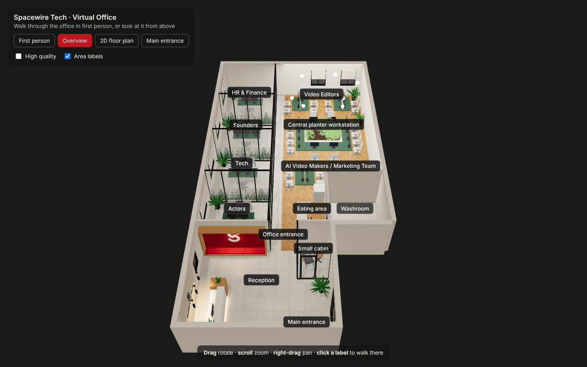
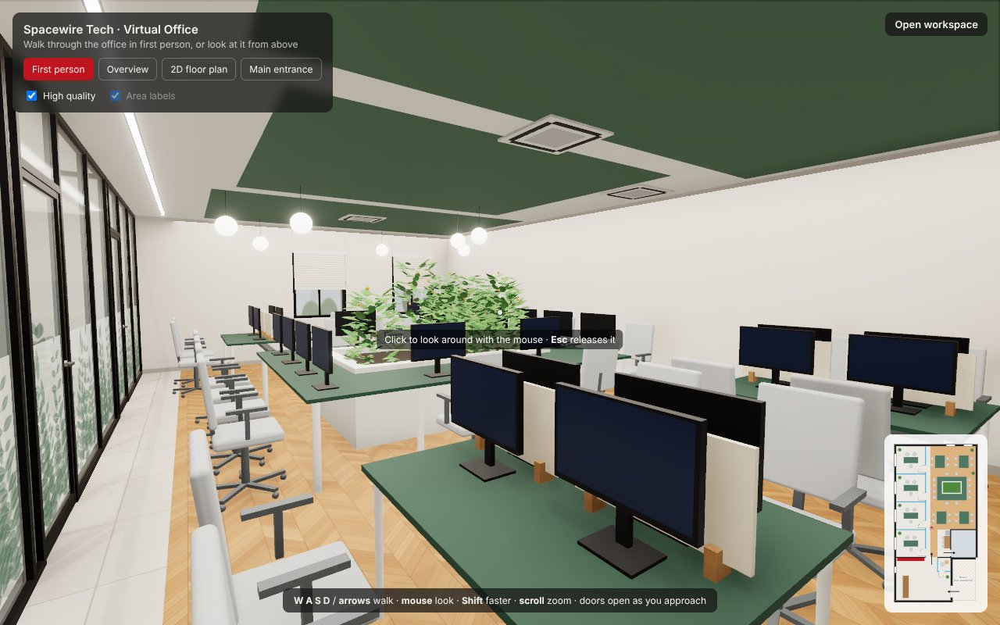
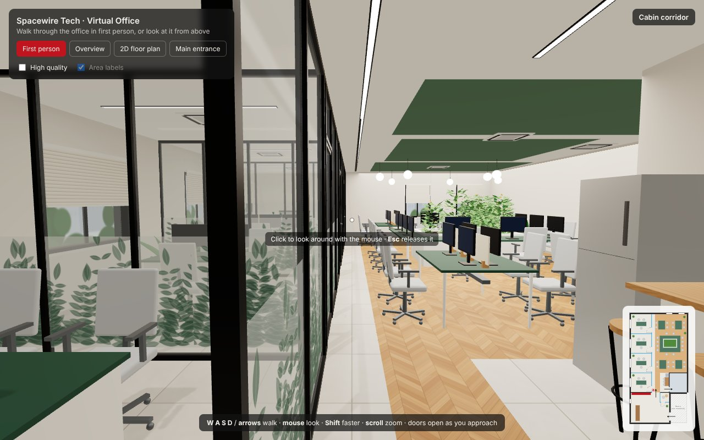
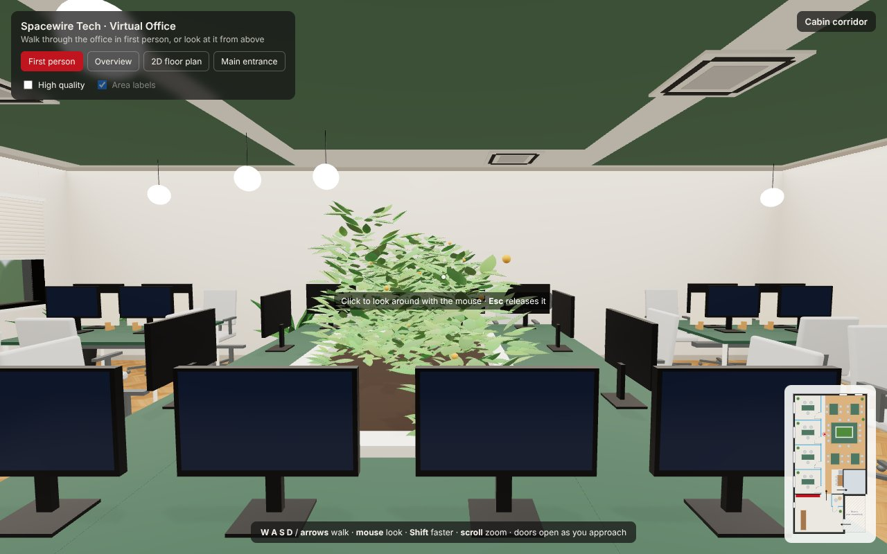
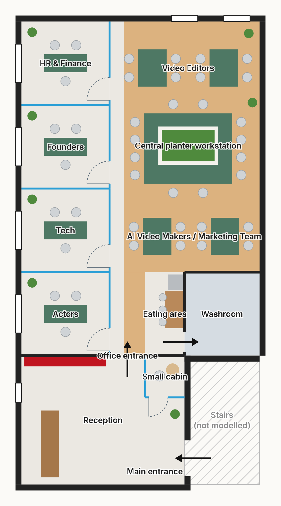

# Spacewire Tech – 3D Virtual Office

A walkable, game-like 3D replica of the Spacewire Tech office. You can walk through it in first person with collision, or orbit it from above.

Built with React, TypeScript, Three.js, React Three Fiber and @react-three/drei.
Everything is real 3D geometry generated from one layout file: walls, glass cabins, desks, chairs, the central planter, ceiling fixtures and doors. There are no panoramas, photos or downloaded 3D models.


## Run it

Requires Node.js 18+ (tested with Node 22).

```bash
npm install
npm run dev          # then open http://localhost:5173
```

Other scripts:

```bash
npm run typecheck    # TypeScript check
npm run build        # production build into dist/
npm run preview      # serve the production build
```

| | |
| --- | --- |
|  |  |
|  |  |

## Controls

| Mode | Controls |
| --- | --- |
| **First person** (default) | **Click** the view to capture the mouse (pointer lock), then move the mouse to look; **Esc** releases it. You can also drag to look. **W A S D** or **↑ ↓** to walk, **← →** to turn, **Shift** to walk faster, **scroll** to zoom. Walls, glass, closed doors and furniture block you. Cabin and small-cabin doors open automatically as you approach. |
| **Overview** | High-angle 3D view with the ceiling removed. **Drag** to rotate, **scroll** to zoom, **right-drag** to pan. **Click an area label** to fly down and walk from there. |
| **2D floor plan** | The top-down plan, with north at the top as in the annotated image. Click an area to walk there. In first person, the minimap in the corner shows where you are. |

Switching between first person and the overview is a smooth camera flight.
**Main entrance** takes you back to the start point.
**High quality** turns on ambient occlusion and bloom; untick it on slower laptops.

URL options:

- `?view=overview` opens the overview directly.
- `?quality=low` turns off high quality.
- `?plan=1` opens the 2D plan.
- `?intro=0` skips the opening fly-in.
- `?cam=x,z,yaw` starts first person at a given point. Coordinates are metres; yaw 0 = north, 90 = west, −90 = east, 180 = south.

## The layout



The annotated floor plan image is the source of truth for positions. It was read like this, with north at the top and the main entrance at the bottom right:

- **Reception** (bottom left): the main entrance is in its east wall and you walk in facing west. The reception desk is straight ahead, with the logo wall and window behind it on the west wall. The red Spacewire feature wall with its bench is on the right, on the south face of the Actors cabin wall. The small interview cabin, with one table and one chair, is in the reception's north-east corner next to the entrance.
- **Office entrance**: an open passage, with no door or gate, between the end of the red wall and the small cabin. It leads north into the cabin corridor and the open workspace.
- **Four cabins** along the west wall, from north to south: HR & Finance, Founders, Tech, Actors. Each has a black-framed glass front on the corridor with a door near its south end, and frosted botanical film on the lower glass. The dividers between cabins are the same glass. The corridor is open to the workspace, with no wall between them.
- **Open workspace**: wooden herringbone floor. Video Editors (two four-seat benches: 2 chairs per side, cream divider panels) at the north end. The central planter workstation in the middle: a white-bordered planter with greenery, green tables on all four sides and 12 seats. AI Video Makers / Marketing Team (two four-seat benches) below it.
- **Eating area and washroom**: the eating area has a lunch counter with stools and a fridge along the washroom wall. The washroom door is entered from the eating area. Only the washroom's closed exterior and door are modelled.
- **Stairs** (bottom right) are excluded from the model, as instructed.

Before building the 3D scene, the metric plan was projected back onto the annotated image (correcting for its perspective) and checked area by area. Rooms, walls, doors and workstation groups all land on the positions drawn in the image.

### Assumptions to confirm with the office photographs

- **Dimensions** are estimated from the image's proportions: about 10 m × 19.4 m inside, with 3.5 m cabins. They are marked `ESTIMATE` in the config.
- **Cabin interiors** follow the annotated image: one green desk, two staff chairs and one visitor chair. The earlier concept captions described a sofa and shooting setup for Actors and a meeting table for Founders. Those can be added once photos confirm them.
- **Windows** are on the west wall (one per cabin, plus the reception window) and the north wall (two, above the Video Editors). Cabin and north windows have venetian blinds.
- **Ceiling**: green ceiling sections over the workspace, cassette AC units, white sphere pendants (positions from the image) and linear LEDs. The exact layout needs ceiling photos.
- **Washroom door** faces the eating area, following the annotation arrow.

## Status

**Working and tested**

- The full office in 3D, generated from the config: shell and windows, four glass cabins, open workspace, central planter workstation, eating area, closed washroom, small cabin and reception.
- First-person walking with pointer lock, WASD, sprint, zoom and smooth acceleration. Collision covers walls, glass, closed doors and furniture. Cabin doors open automatically.
- The overview, smooth camera flights between modes, clickable area labels, a live minimap and the 2D plan.
- A collision flood-fill test confirms every room and every hotspot is reachable from the entrance. The washroom interior, the stairs and the outside are not reachable.
- Interactive checks in a headless browser: walking stops at the reception desk, hotspots fly to the right spot, and a cabin door opens as you walk through. No console errors in development or production builds.

**Needs your input**

- Office photographs, to match the cabin interiors, ceiling (green sections, AC and light positions), windows and finishes exactly.
- Real dimensions (overall length and width, cabin sizes). These are one-line changes in the config.

## Changing the layout

Everything is in **`src/config/office.ts`**, with a plan diagram at the top:

| Constant | Controls |
| --- | --- |
| `OFFICE`, `GRID`, `CEILING_HEIGHT` | Overall size and the main grid lines (cabin fronts, corridor, eating area, washroom, reception) |
| `AREAS` | Rooms and zones: floor type (tile or wood), labels and the walk-to viewpoint |
| `CABINS`, `CABIN_DOOR`, `CABIN_FURNITURE` | Cabin order and sizes, door position, desk, chairs and monitors |
| `WALLS` | Exterior and interior walls with their windows and doors |
| `GLASS` | Glass partitions, botanical film and automatic doors |
| `RECEPTION`, `SMALL_CABIN`, `MAIN_ENTRANCE` | Reception desk, logo wall, pendants, red feature wall, small cabin, entrance |
| `BENCHES`, `BENCH`, `PLANTER_WORKSTATION` | Workstation clusters and the central planter |
| `EATING_AREA`, `WASHROOM_DOOR` | Lunch counter, stools, fridge, washroom door |
| `CEILING` | Green ceiling sections, AC cassettes, sphere pendants, linear LEDs |
| `SPAWN`, `HOTSPOTS`, `OVERVIEW_CAMERA` | Start point, clickable areas, overview camera |

The 3D scene, the 2D plan, the minimap, the hotspots and the collision map are all generated from this file, so they stay in sync. Colours and finishes are in `src/config/appearance.ts`; light levels are in `LIGHT_LEVELS` in `src/scene/Lights.tsx`.

## Branding assets

- **Logo:** `public/assets/spacewire-s-mark.svg` was traced from the supplied reception reference. Replace it with the official vector logo under the same file name and every 3D logo updates.
- **Lettering:** "Spacewire Tech" uses a subset of Inter Medium (SIL Open Font License, see `public/fonts/`).

## Project structure

```
src/
  config/office.ts          ← the whole layout (single source of truth)
  config/appearance.ts      ← colours, tile / wood sizes
  scene/Office.tsx          ← assembles the office
  scene/OfficeShell.tsx     walls, windows + blinds, doors, floors, outside view
  scene/GlassPartition.tsx  black-framed glass, botanical film, automatic doors
  scene/Ceiling.tsx         ceiling, green sections, AC units, pendants, LEDs
  scene/ReceptionArea.tsx   reception desk, logo wall, red feature wall, small cabin
  scene/OfficeFurniture.tsx instanced chairs / monitors, benches, planter, cabin desks, eating area
  scene/placements.ts       every chair / monitor / desk position (shared by 3D, plan, collisions)
  scene/Lights.tsx, materials.ts, textures.ts, Plant.tsx, Furniture.tsx, SpacewireLogo.tsx
  nav/Navigation.tsx        first-person controller, overview orbit, camera flights
  nav/colliders.ts          collision map + wall sliding
  nav/player.ts, nav/hud.ts visitor state, area name, minimap marker
  ui/FloorPlan2D.tsx        2D plan / minimap (SVG)
  ui/Hotspots.tsx, ui/Overlay.tsx
public/assets/spacewire-s-mark.svg
public/fonts/inter-medium-spacewire.typeface.json
tools/trace_logo.py         how the logo was traced from the reference image
```
