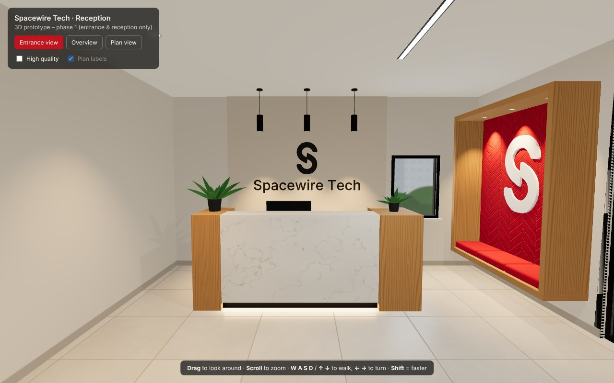
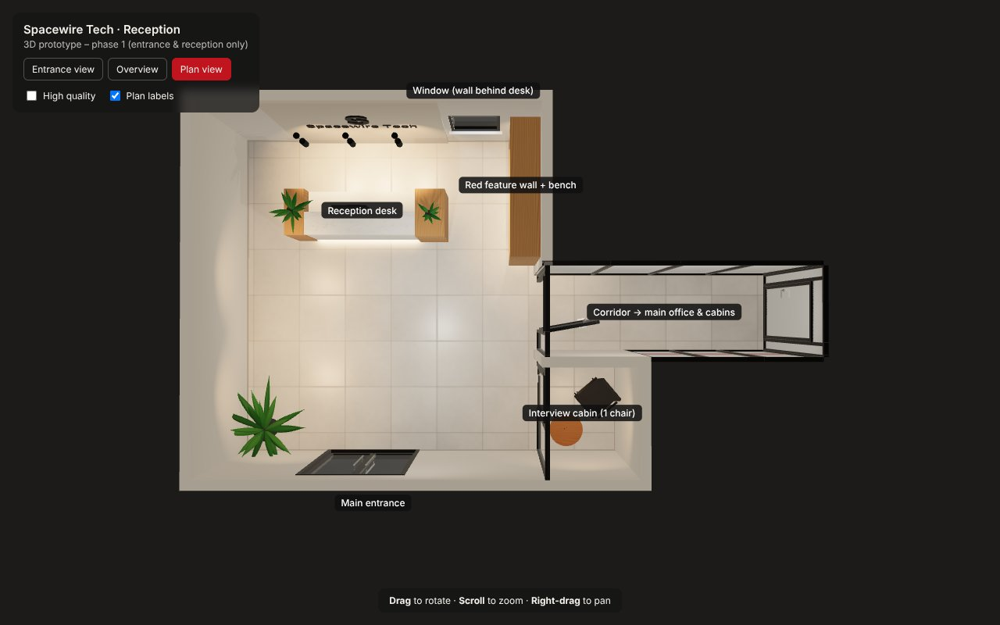

# Spacewire Tech – 3D Virtual Office

**Phase 1: reception and entrance prototype**, for layout approval before the rest of
the office is built.

Built with React, TypeScript, Three.js, React Three Fiber and @react-three/drei.
Everything is real 3D geometry: floor, walls, ceiling, desk, window, feature wall,
bench, doors and glass partitions. No panoramas or flat photos are used.



## Run it

Requires Node.js 18+ (tested with Node 22).

```bash
npm install
npm run dev          # http://localhost:5173
```

Other scripts:

```bash
npm run typecheck    # TypeScript check
npm run build        # production build into dist/
npm run preview      # serve the production build
```

### Controls

| View | How to use it |
| --- | --- |
| **Entrance view** (default) | Starts at the main entrance, facing the reception desk. Drag to look around, scroll to zoom. **W A S D** or **↑ ↓** to walk, **← →** to turn, **Shift** to walk faster. Walls and furniture block movement. The button resets to the fixed entrance view. |
| **Overview** | 3D overview with the ceiling removed. Drag to orbit, scroll to zoom, right-drag to pan. |
| **Plan view** | Top-down view with the entrance at the bottom, the same orientation as the floor plan. Use it to compare against the plan. |

Options:

- **High quality**: polished-floor reflections, ambient occlusion and LED bloom. Untick it on slow laptops.
- **Plan labels**: names the areas in the Overview and Plan views. These are screen labels, not signage inside the office.

URL parameters:

- `?view=plan` or `?view=overview` opens that view directly.
- `?quality=low` turns off high quality.
- `?cam=x,z,yaw,pitch` starts the walk-through at a given spot and direction, which is handy for sharing a viewpoint. For example, `?cam=1,1.8,-80,0` looks into the interview cabin. Yaw 0 faces the desk, 90 faces left and −90 faces right.

## How the reception layout was interpreted



```
              BACK WALL (logo + window) – closed, no doorway
        ┌─────────────────────────────────┐
        │   [ RECEPTION  DESK ]   [win]   │▐ RED FEATURE
        │                                 │▐ WALL + BENCH
        │                                 │▐
        │                      glass door ╞═════════════► corridor to the
        │                                 ├────┐           main office
        │ plant                           │ IC │ INTERVIEW CABIN
        └──────────[ ENTRANCE ]───────────┴────┘
                         ▲ visitor
```

The lobby is about 5.0 × 5.4 m (estimate).

- **Entrance:** a black-framed double glass door in the front (bottom) wall. The visitor walks in facing the back wall.
- **Reception desk:** directly in front of the entrance, on the same centre line, with its front facing the entrance. It has a white marble-style front panel, natural wood end blocks, a warm LED glow under the panel, a marble ledge, and a receptionist work surface with a monitor behind it.
- **Wall behind the desk:** a closed wall. It carries a feature panel with the dark Spacewire "S" and "Spacewire Tech" in 3D letters, three pendant lights, and a window to the right of the logo, as in the latest reception reference. There is no corridor, hallway or doorway behind the desk.
- **Red feature wall:** on the right side wall, directly to the visitor's right. It has a natural wood box frame, a deep-red chevron upholstered panel, a large white "S", a built-in red cushioned bench (3 cushions) and warm downlights in the top of the frame. It is not behind the desk.
- **Small interview cabin:** a very small enclosed room (about 1.4 × 1.6 m) next to the entrance on the right. It has a black-framed glass front and glass door, and holds one chair and one small round table, nothing else.
- **Office corridor:** starts beyond the reception area, through a black-framed glass partition and door in the right wall, between the red feature wall and the interview cabin. Where the corridor runs beside the cabin, the cabin's solid side wall forms the corridor wall. It is narrow (1.3 m), with glass partitions, a red band on the right-hand glass and a white linear LED down the centre, as in the corridor photo. The 4 m stub ends at a glass door to the main office, which is the next phase. The corridor glass is frosted for now, because the rooms behind it are not built yet.
- **Materials and lighting:** large light-grey square floor tiles, warm off-white walls, black aluminium frames, white linear LED strips, and warm recessed lights and pendants. Shadows are real-time.

### Review status

- **Confirmed in review:** entrance, reception desk, window wall, red feature wall and interview cabin positions. The corridor was moved from the left wall to the right wall and all sizes were made more compact, as requested.
- **Dimensions:** all are reasonable estimates and are marked `ESTIMATE` in the config. Measured sizes can be typed in directly.
- **Source:** the hand-drawn floor plan was not among the images received. The layout follows the written brief, the photo captions, the latest reception concept and the review feedback above.

## Adjusting the layout

All positions, sizes and rotations are in **`src/config/layout.ts`**, with clearly named constants and a coordinate diagram at the top:

| Constant | Controls |
| --- | --- |
| `LOBBY`, `CEILING_HEIGHT`, `WALL_THICKNESS` | Room size |
| `ENTRANCE` | Door position on the front wall, width and height |
| `RECEPTION_DESK` | Position (follows the entrance by default), size, gap to the back wall, end-block widths, rotation |
| `LOGO_WALL`, `BACK_WINDOW`, `PENDANTS` | Logo panel, logo/lettering size and height, window position and size, pendant lights |
| `RED_FEATURE_WALL` | Which wall, extent, frame depth, logo size, cushions, downlights, chevron size |
| `INTERVIEW_CABIN` | Which wall, extent, depth, door, table and chair positions |
| `CORRIDOR` | Which wall, width, length, door, frosted glass, red band |
| `LINEAR_LEDS`, `DOWNLIGHTS`, `FLOOR_PLANTS`, `DESK_PLANTS` | Fixtures and plants |
| `INITIAL_CAMERA` | The fixed first view from the entrance |

Coordinates: **+X = visitor's right, −Z = straight ahead (towards the desk), Y = up**, in metres, with the origin at the centre of the lobby floor. The feature wall, cabin and corridor can each be moved to another wall by changing their `wall` field.

Colours, tile size and finishes are in `src/config/appearance.ts`. Light levels are in `LIGHT_LEVELS` in `src/scene/Lights.tsx`.

## Branding assets

- **Logo:** `public/assets/spacewire-s-mark.svg` is the Spacewire "S", **traced from the supplied reception reference image** (`tools/trace_logo.py`), because no logo file was provided. Replace it with the official vector logo under the same file name and both 3D logos update automatically. The SVG must be a filled path.
- **Lettering:** "Spacewire Tech" uses a subset of the Inter Medium typeface (SIL Open Font License, see `public/fonts/`). If Spacewire has a brand typeface, it can be converted the same way.

## Status

**Working**

- 3D reception and entrance: floor, walls, ceiling, entrance door, desk, logo wall, window, red feature wall and bench, interview cabin, start of the corridor.
- PBR materials with procedural textures (tiles, marble, wood, red chevron).
- Linear LED, recessed and pendant lighting with real-time shadows. Image-based reflections from local light formers; no downloads needed.
- Optional high-quality mode: floor reflections, ambient occlusion and bloom.
- Fixed initial entrance view, free-look, zoom, keyboard walking with collision, and the Overview and Plan views.
- Verified in a headless Chromium (software WebGL) in dev and production builds, with no runtime errors. Screenshots are in `docs/screenshots/`.

**Not done yet (by design, for later phases)**

- The rest of the office: main office floor, team areas, HR/Founders/Tech/Actors cabins, lunch slab and washroom.
- Google-Maps-style navigation (hotspots, click-to-move, minimap).
- The office photographs are not used as textures. Floor, marble, wood and fabric are procedural approximations.

**Known limitations**

- The traced logo is accurate in shape but slightly soft at the edges. Use the official SVG for a crisp result.
- Performance has only been checked under software rendering. On a normal laptop GPU it should run smoothly; if not, untick **High quality**.

## Project structure

```
src/
  config/layout.ts        ← every position / size / rotation
  config/appearance.ts    ← colours, tile size
  scene/Reception.tsx     ← assembles the scene
  scene/ReceptionDesk.tsx, BackWall.tsx, RedFeatureWall.tsx,
        InterviewCabin.tsx, Corridor.tsx, Entrance.tsx
  scene/GlassPartition.tsx  black-framed glass partitions and doors
  scene/primitives.tsx      walls with openings, floor/ceiling patches
  scene/Lights.tsx          LED strips, downlights, pendants, environment
  scene/CameraRig.tsx       entrance walk/look controls, overview/plan cameras
  scene/textures.ts         procedural textures
public/assets/spacewire-s-mark.svg
public/fonts/inter-medium-spacewire.typeface.json
tools/trace_logo.py       how the logo was traced from the reference image
```
